# Maneuverability — 2026-11-01

[Motion / GPS workbook](Motion_GPS.xlsx?raw=true) · [Activity index](Activity_index.xlsx?raw=true) · [Testing request #17](https://github.com/McGill-Baja-Racing/Testing/issues/17)

Each figure pairs the GPS path with speed, three accelerations, and three angular rates from the same window. Matching A/B/C markers connect locations to time traces. Only retained slalom, figure-eight and maneuverability groups are included.

## Slalom

175.csv · 12:05:00–12:13:33 nominal Montreal time

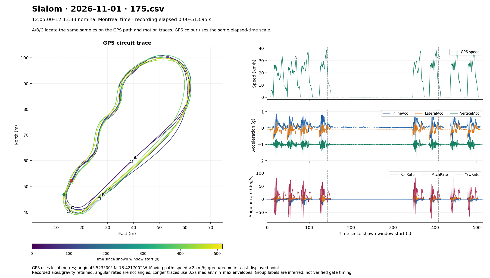

176.csv · 12:20:00–12:24:39 nominal Montreal time

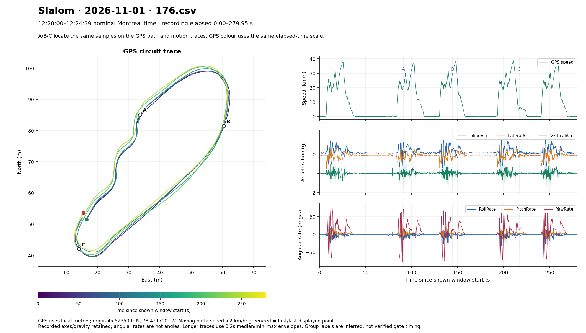

177.csv · 12:30:00–12:34:07 nominal Montreal time

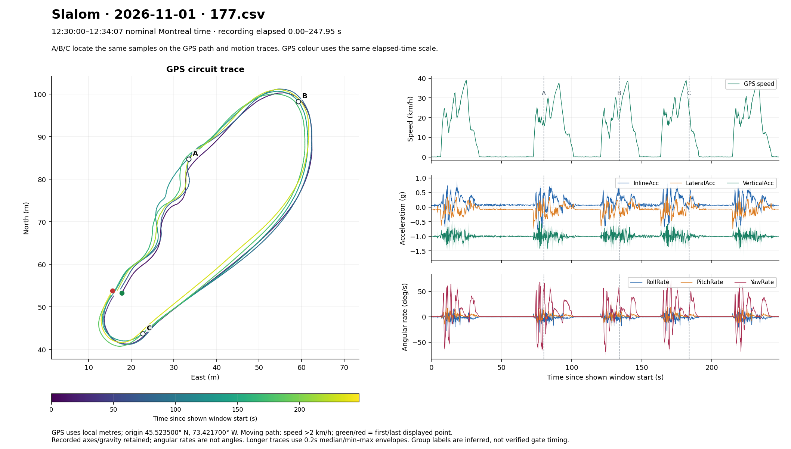

178.csv · 12:39:00–12:44:07 nominal Montreal time

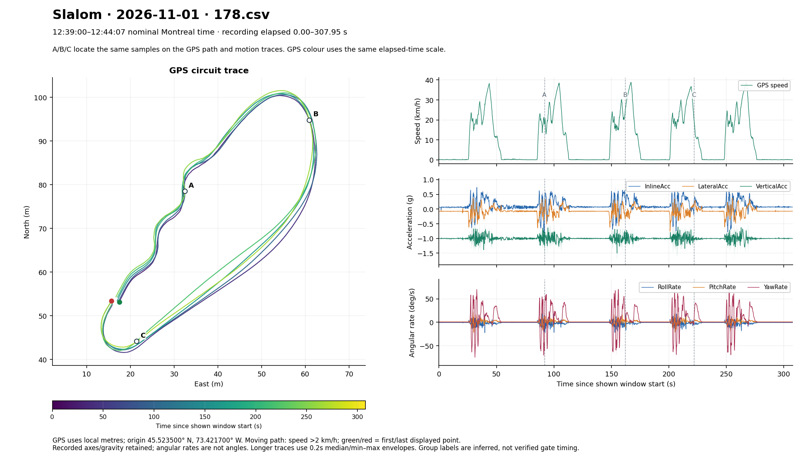

179.csv · 12:49:00–12:52:23 nominal Montreal time

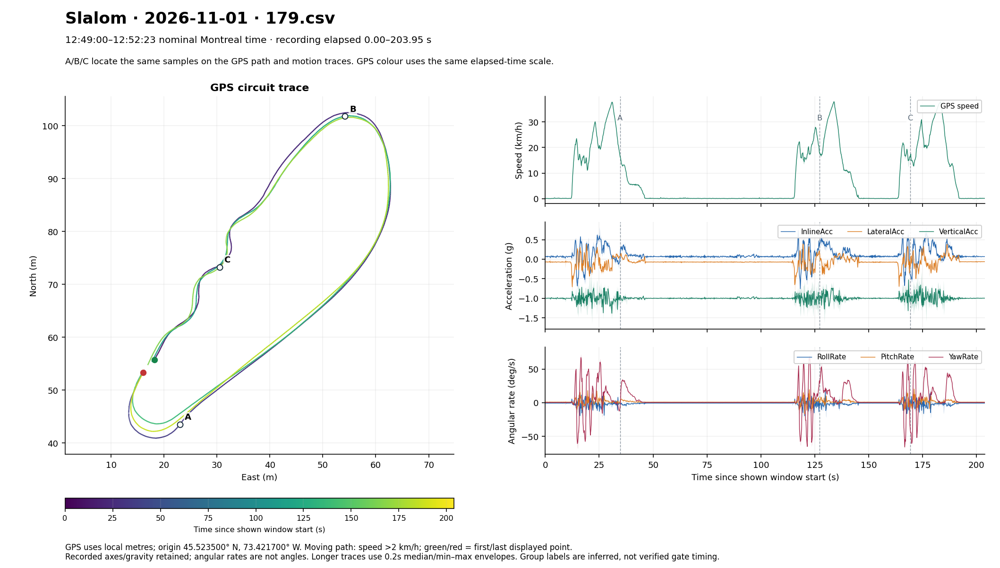

180.csv · 12:57:00–13:03:19 nominal Montreal time

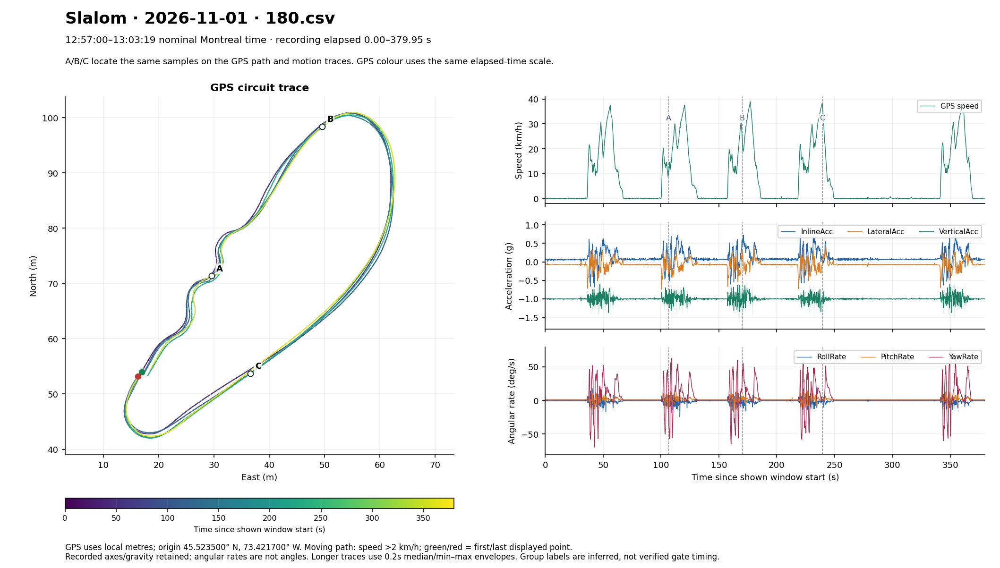

181.csv · 13:06:00–13:12:02 nominal Montreal time

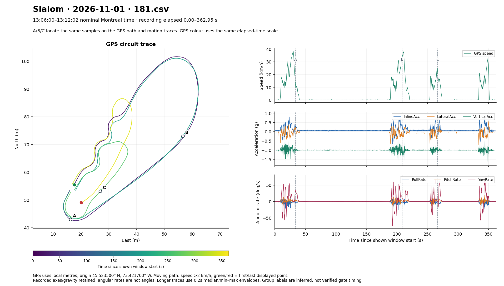

194.csv · 16:29:00–16:45:02 nominal Montreal time

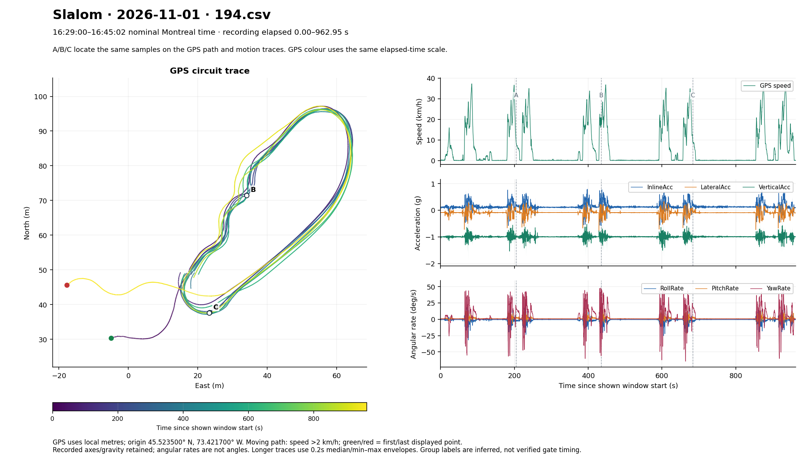

## Figure eight

188.csv · 14:16:00–14:24:09 nominal Montreal time

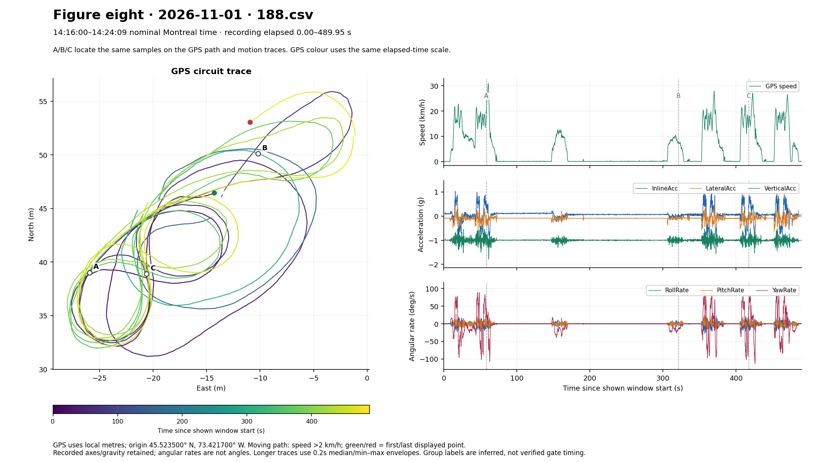

189.csv · 14:27:00–14:30:12 nominal Montreal time

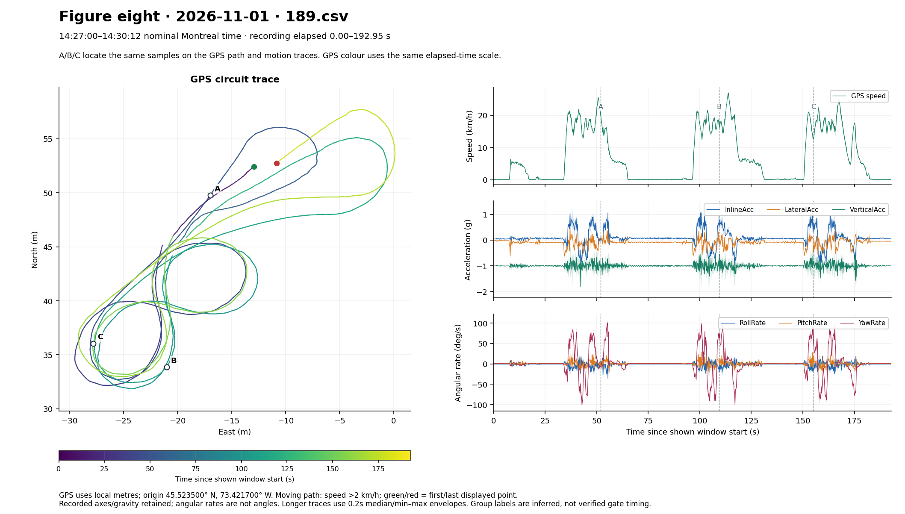

195.csv · 16:49:00–16:54:40 nominal Montreal time

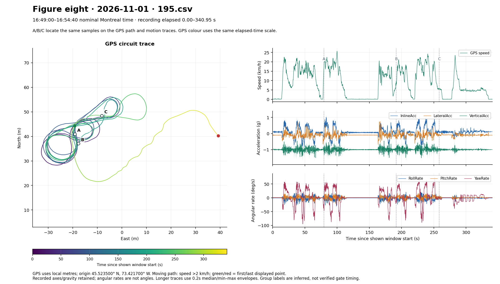

## Maneuverability circuit

184.csv · 13:43:00–13:56:13 nominal Montreal time

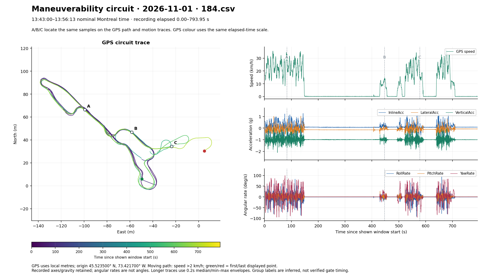

192.csv · 16:15:00–16:25:18 nominal Montreal time

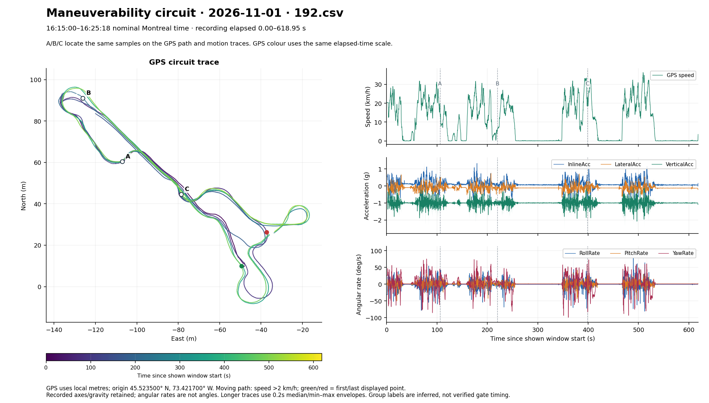

## Notes

Group labels reflect the reviewed GPS patterns and source notes; exact trial/gate boundaries remain unverified. Recording blocks may include setup and return driving. AiM time is nominal, axes/gravity are retained, and angular rates are not roll/pitch angles. No matching left-rear shock or front-left lower-arm/knuckle data overlaps these selected windows.

[Full original files](source/README.md)
