# Maneuverability — 2026-11-08

[Motion / GPS workbook](Motion_GPS.xlsx?raw=true) · [Activity index](Activity_index.xlsx?raw=true) · [Testing request #17](https://github.com/McGill-Baja-Racing/Testing/issues/17)

Each figure pairs the GPS path with speed, three accelerations, and three angular rates from the same window. Matching A/B/C markers connect locations to time traces. Only retained slalom, figure-eight and maneuverability groups are included.

## Slalom

160.csv · 18:42:05–18:42:39 nominal Montreal time

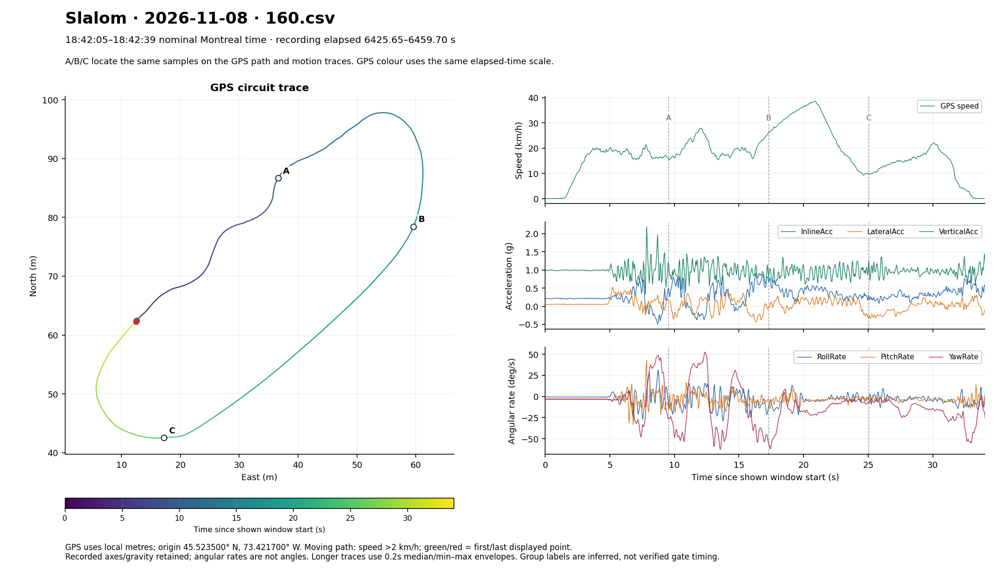

160.csv · 18:43:04–18:43:37 nominal Montreal time

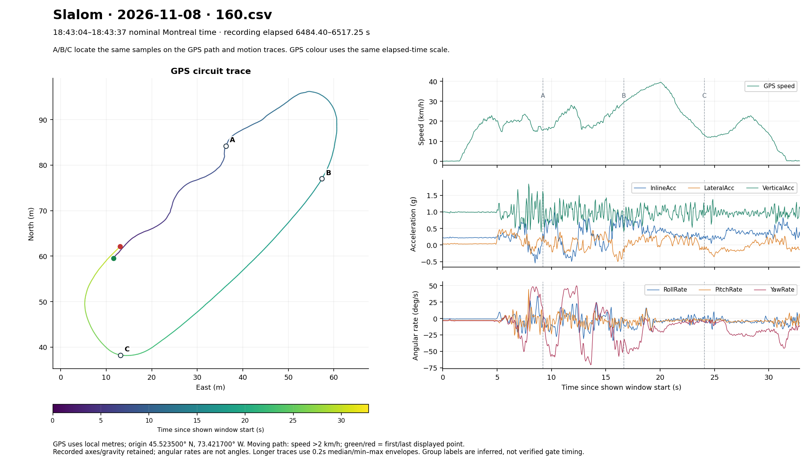

160.csv · 18:45:52–18:46:27 nominal Montreal time

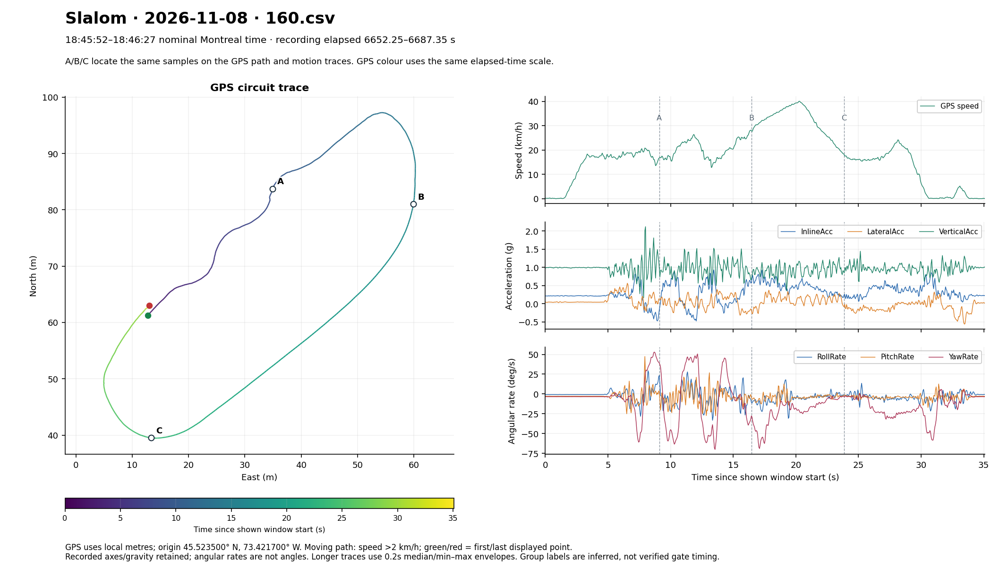

160.csv · 18:46:36–18:47:08 nominal Montreal time

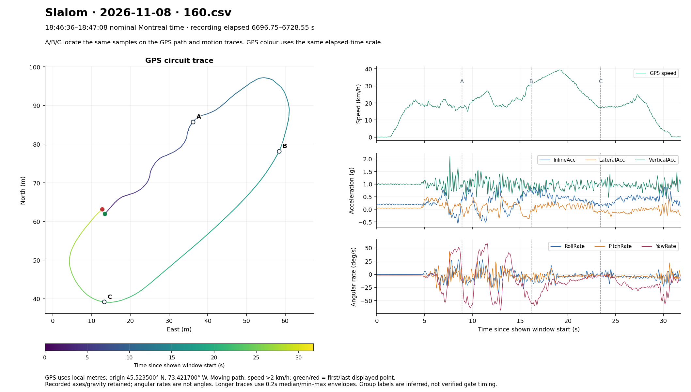

160.csv · 18:49:29–18:50:00 nominal Montreal time

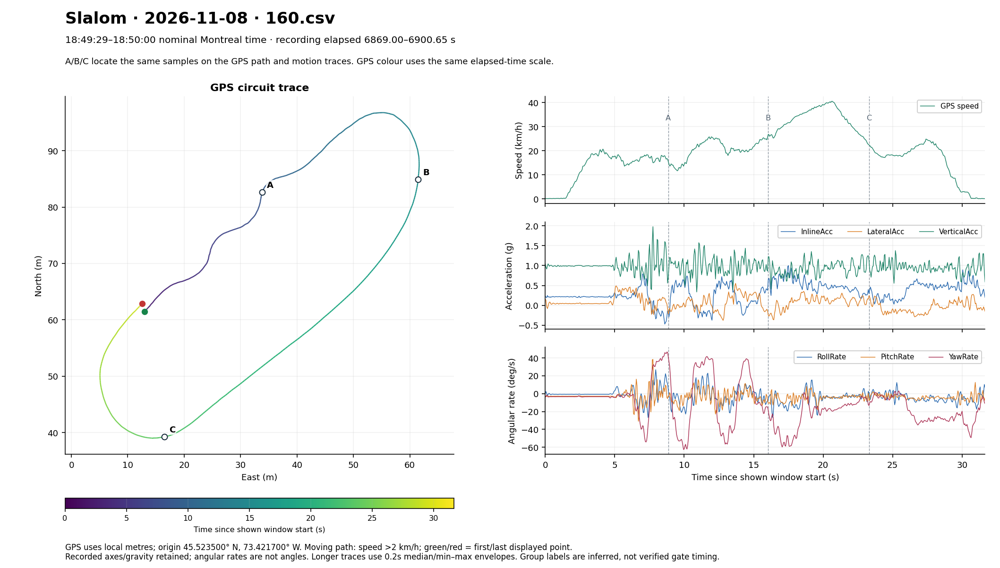

160.csv · 18:50:31–18:51:03 nominal Montreal time

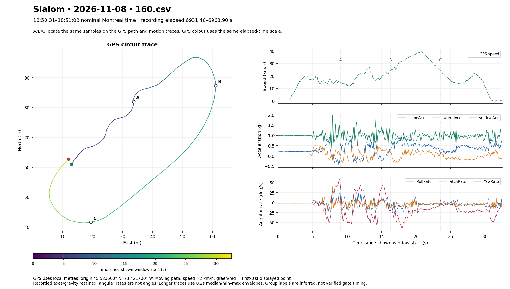

160.csv · 18:52:52–18:53:25 nominal Montreal time

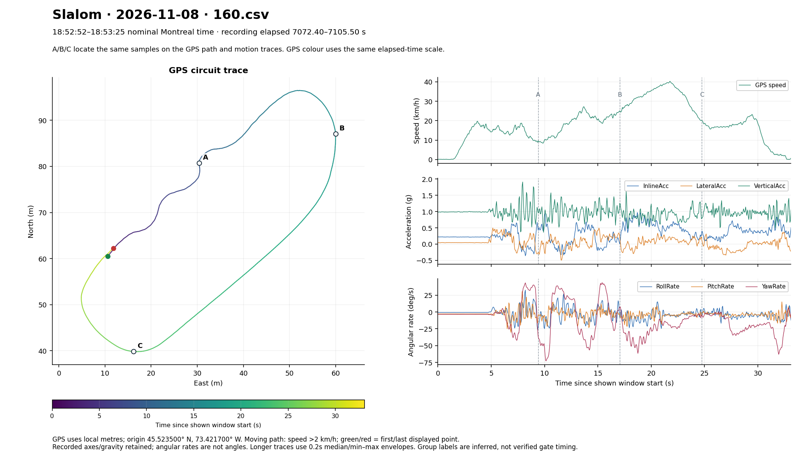

160.csv · 18:53:37–18:54:08 nominal Montreal time

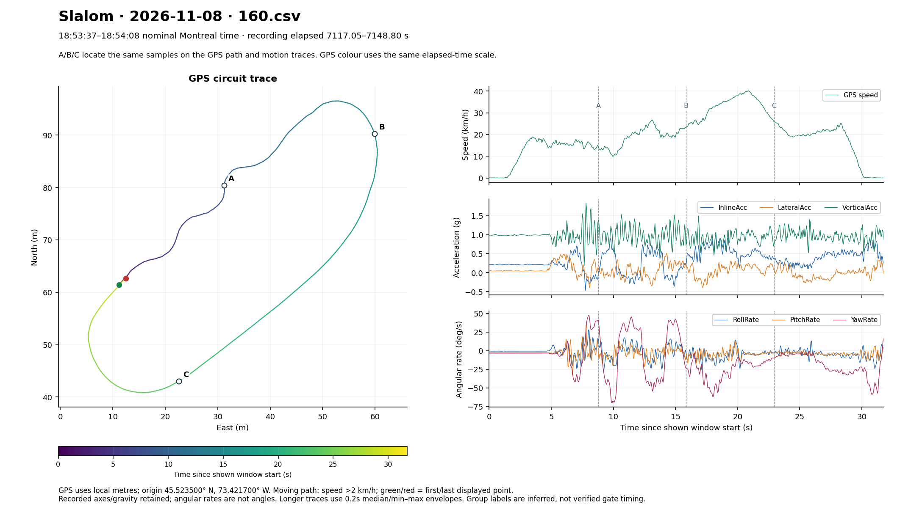

161.csv · 18:58:38–18:59:15 nominal Montreal time

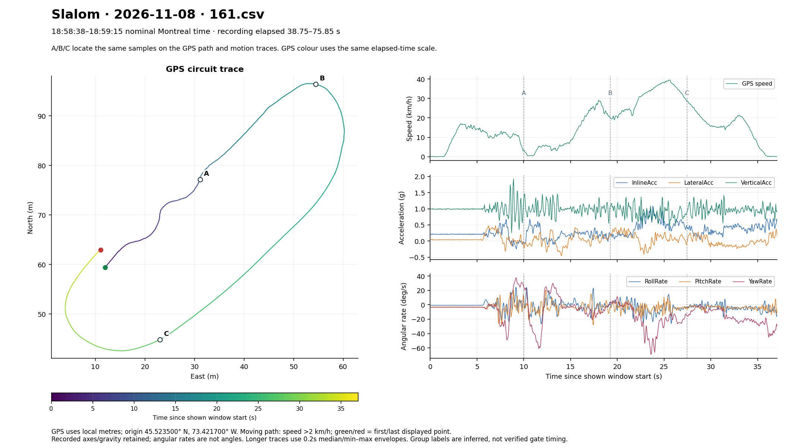

161.csv · 19:00:27–19:01:01 nominal Montreal time

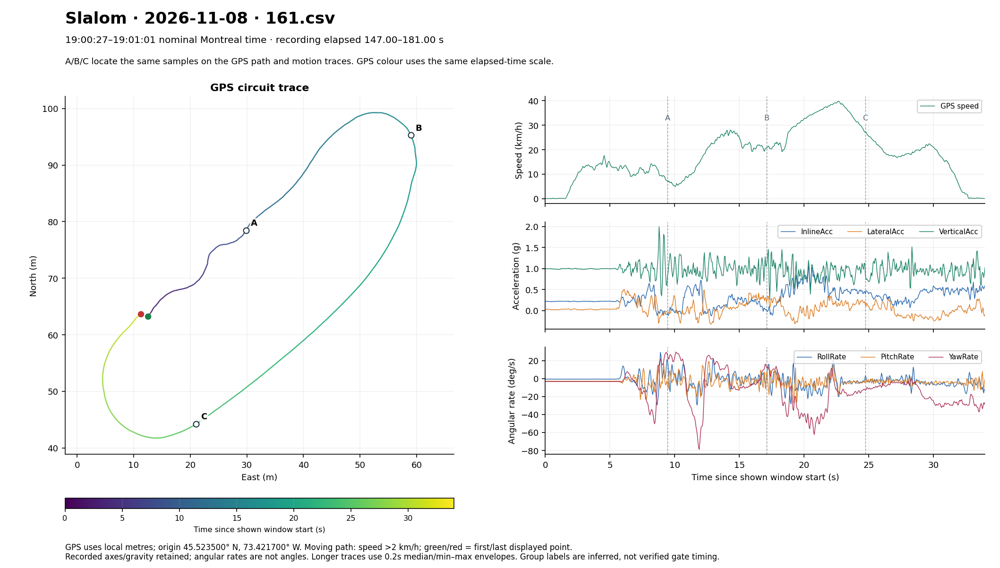

161.csv · 19:02:32–19:03:05 nominal Montreal time

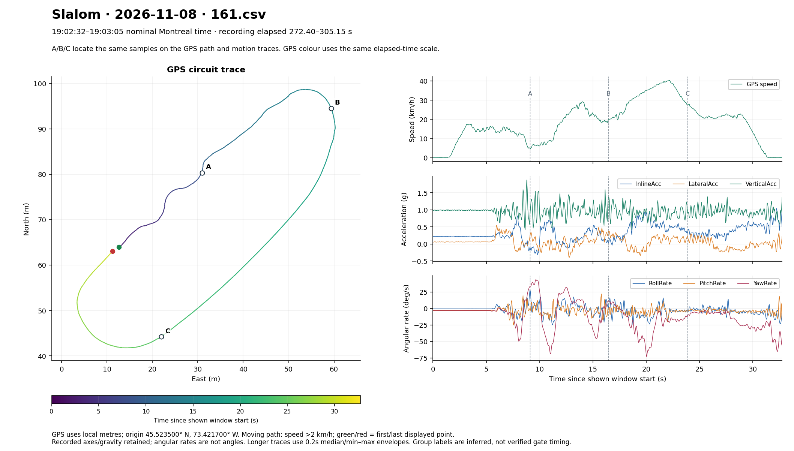

161.csv · 19:03:15–19:03:49 nominal Montreal time

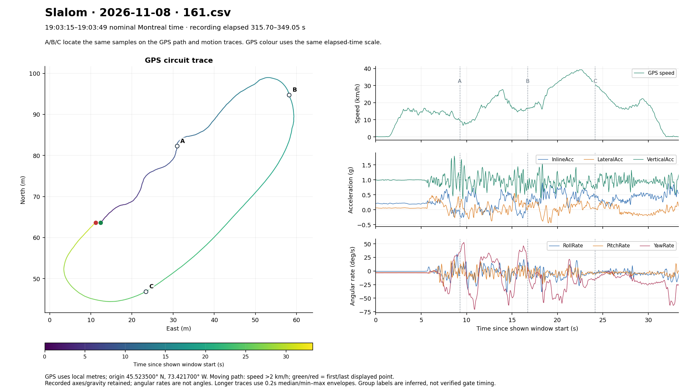

161.csv · 19:05:41–19:06:12 nominal Montreal time

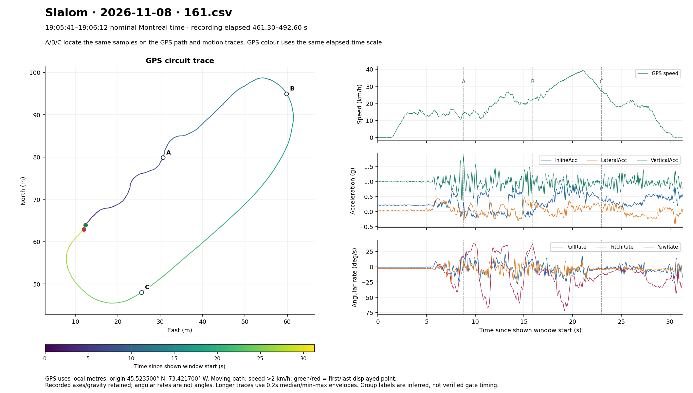

## Notes

Group labels reflect the reviewed GPS patterns and source notes; exact trial/gate boundaries remain unverified. Recording blocks may include setup and return driving. AiM time is nominal, axes/gravity are retained, and angular rates are not roll/pitch angles. No matching left-rear shock or front-left lower-arm/knuckle data overlaps these selected windows.

[Full original files](source/README.md)
