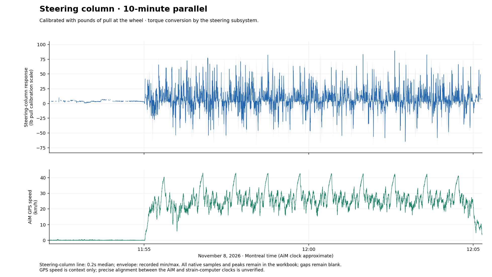
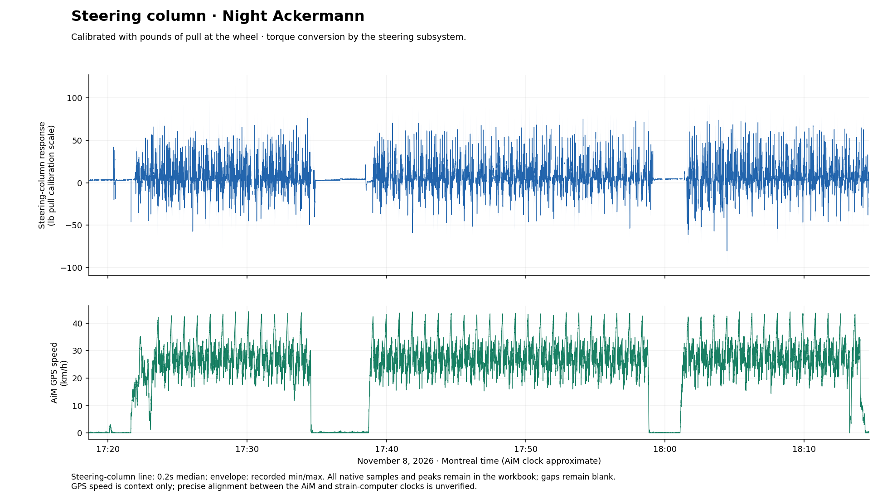

# Steering-column recordings — November 8, 2026

MB26 · ENA.

[Steering-column Excel](Steering_column.xlsx) — separate sheets for parallel and night Ackermann; all 232,561 native samples.

## 10-minute parallel

11:52:07–12:05:16 Montreal time.

## Night Ackermann

17:18:36–18:14:41 Montreal time.

## Calibration note

- Calibrated using pounds of pull at the steering wheel. These are recorded values on that calibration scale; the steering subsystem will convert them to torque using its calibration/loading geometry.
- All native samples and peaks are retained. No offset subtraction, re-zeroing, filtering or recalibration has been applied. Clock synchronization between AiM and the strain computer is unverified; gaps remain.

[Original files](https://github.com/McGill-Baja-Racing/Testing/releases/download/ena-2026-11-01-08/ENA_Nov1_Nov8_all_supplied_sources.zip) · [November 8 video](https://mcgill.sharepoint.com/:f:/r/sites/McGill_Baja_Group/Shared%20Documents/Drivers/MB26_Trainning/ENA%20Testing/Nov%208?d=w86e5a5a1d0dc4dd38bc664b2aefacb35&csf=1&web=1&e=pThiBI)
