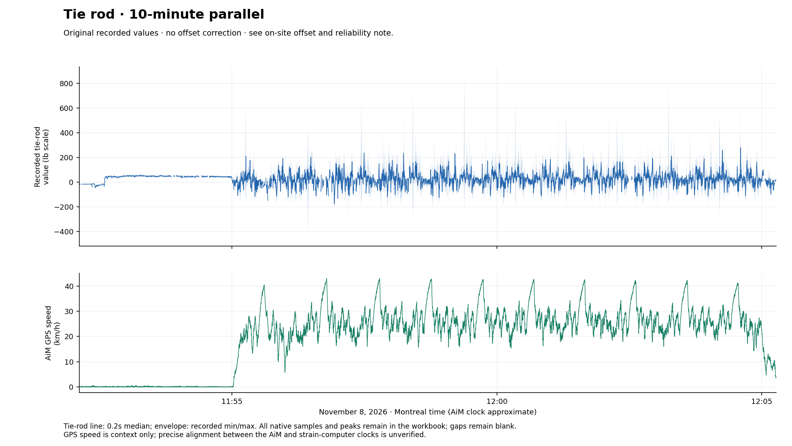
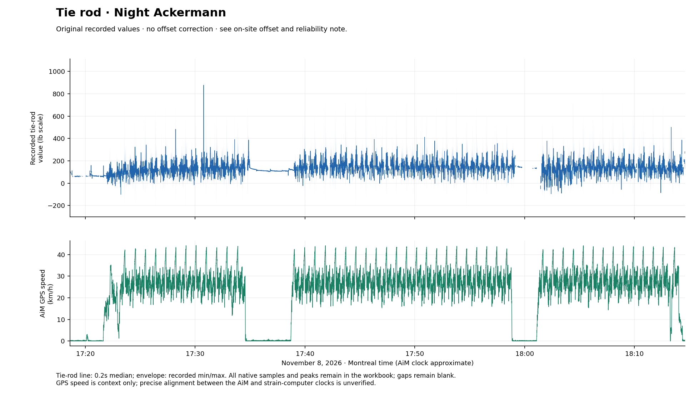

# Tie-rod recordings — November 8, 2026

MB26 · ENA.

[Tie-rod Excel](Tie_rod.xlsx) — separate sheets for parallel and night Ackermann; all 223,291 native samples.

## 10-minute parallel

11:52:07–12:05:16 Montreal time.

## Night Ackermann

17:18:36–18:14:36 Montreal time.

## Offset and reliability note

- The sensor developed a substantial on-site offset and early reliability concerns. Temperature was suspected but not confirmed as the cause. It was believed to have been zeroed early in the day, with no later re-zeroing known.
- Calibration values were entered directly in pounds, with a compression setup. Values are supplied exactly as recorded; no offset subtraction, re-zeroing, recalibration or peak removal has been applied.
- Account for the offset and assess isolated large peaks before calculating maximum axial loads. The recordings alone do not establish a validated absolute-force correction. Positive-force sign and instrumented side remain unconfirmed.

[Original files](https://github.com/McGill-Baja-Racing/Testing/releases/download/ena-2026-11-01-08/ENA_Nov1_Nov8_all_supplied_sources.zip) · [November 8 video](https://mcgill.sharepoint.com/:f:/r/sites/McGill_Baja_Group/Shared%20Documents/Drivers/MB26_Trainning/ENA%20Testing/Nov%208?d=w86e5a5a1d0dc4dd38bc664b2aefacb35&csf=1&web=1&e=pThiBI)
